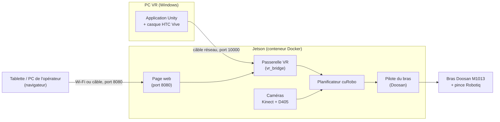

# 1. Vue d'ensemble et glossaire

## Ce que fait le système

Un visiteur, casque VR sur la tête, tient une manette. Quand il appuie sur la **gâchette**, le bras du robot suit le mouvement de sa main. Il peut ouvrir et fermer la pince. À côté, un étudiant surveille l'état du robot sur une tablette ou un PC, avec une page web.

Tout le logiciel du robot tourne dans **un seul conteneur Docker** sur le Jetson. Seuls le PC VR (application Unity sous Windows) et la tablette de l'opérateur sont à l'extérieur.

## Glossaire

| Mot | Ce que ça veut dire ici |
|---|---|
| **Jetson** | Le petit ordinateur (NVIDIA Jetson) posé sur le robot. Il commande le bras. |
| **Conteneur Docker** | Une « boîte » qui contient tout le logiciel du robot, déjà installé. On la démarre, on ne l'installe pas à la main. |
| **Image Docker** | Le « modèle » téléchargé depuis internet pour créer le conteneur. |
| **Module** | Un morceau du logiciel (caméras, pilote du bras, planificateur, casque VR…). La page web les démarre et les surveille. |
| **Prêt / Problème / Échec** | L'état d'un module : *Prêt* = fonctionne, *Problème* = fonctionne mal, *Échec* = ne s'est pas lancé. |
| **cuRobo** | Le logiciel de calcul de trajectoire qui **évite les obstacles** vus par les caméras. |
| **Doosan (contrôleur)** | Le mode de commande direct du bras. Plus fluide à la dépose, mais **ne vérifie pas les obstacles**. Voir le [chapitre 10](10-curobo-doosan.md). |
| **Pilote** | Le poste (tablette ou PC) qui a la main sur le robot. Un seul à la fois. Les autres sont en « Observation seule ». |
| **Mode de commande** | Qui commande le bras : *Aucun* (bras immobile), *Casque VR*, ou *Depuis ce PC* (souris). |
| **Maintien (homme-mort)** | Il faut **maintenir** la gâchette (ou le bouton de la souris) pour que le bras bouge. On lâche : le bras s'arrête. |
| **Teach pendant** | La tablette de commande fournie avec le bras Doosan, avec son arrêt d'urgence. |
| **Terminal** | Une fenêtre où l'on tape des commandes. Seul le technicien en a besoin. |
| **IP** | L'adresse d'un appareil sur le réseau (par exemple `192.168.50.12`). |

Ce que voit le visiteur dans le casque est détaillé au [chapitre 9](09-casque-vr.md) (voir la capture du pavillon virtuel).

> **Capture à ajouter** : photo du robot en situation de démonstration, avec les éléments annotés (bras, pince, caméra Kinect, caméra D405, Jetson).
