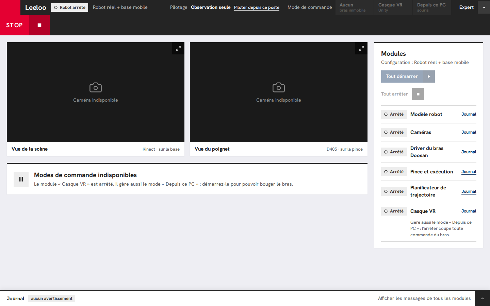

# 4. Installer le Jetson

> Chapitre pour le **technicien**. À faire une seule fois par Jetson.

## Ce qu'on suppose

- Le Jetson est déjà sous **JetPack** (Ubuntu fourni par NVIDIA). Si ce n'est pas le cas, suivre d'abord le guide officiel de flash de NVIDIA (« SDK Manager » / documentation JetPack) : ce n'est pas détaillé ici.
- **Docker n'est pas installé** : ce chapitre l'installe.
- Le Jetson est branché en ethernet au routeur du robot, **avec accès à internet** le temps de l'installation (pour télécharger Docker et l'image).

Les commandes se tapent dans un **terminal** sur le Jetson (clavier et écran branchés, ou connexion à distance par SSH). Le symbole `$` indique « une commande à taper » : ne pas le recopier.

## Étape 1 : installer Docker

Suivre la procédure officielle d'installation de **Docker Engine pour Ubuntu** (documentation Docker, section « Install using the apt repository »), puis vérifier :

```bash
$ docker --version
$ docker compose version
```

On doit voir un numéro de version pour chacune.

Autoriser votre utilisateur à utiliser Docker sans `sudo` (puis **se déconnecter / se reconnecter**) :

```bash
$ sudo usermod -aG docker $USER
```

Vérifier que le Jetson peut utiliser le GPU depuis un conteneur (JetPack fournit en général l'environnement d'exécution NVIDIA) :

```bash
$ docker info | grep -i runtimes
```

On doit voir `nvidia` dans la liste.

> **À COMPLÉTER / à vérifier sur un Jetson neuf** : commandes exactes d'installation de Docker et du runtime NVIDIA selon la version de JetPack.

## Étape 2 : récupérer le dépôt

Le dépôt git contient le fichier `docker-compose.yml` et cette documentation.

```bash
$ cd ~
$ git clone https://github.com/Lab-CORO/leeloo_porte_ouverte.git
$ cd leeloo_porte_ouverte
```

## Étape 3 : télécharger l'image et démarrer

L'image est stockée sur Docker Hub. La première fois, le téléchargement est long (plusieurs Go).

```bash
$ docker compose pull
$ docker compose up -d
```

`up -d` démarre le conteneur en arrière-plan. Vérifier :

```bash
$ docker compose ps
```

La colonne `STATUS` doit indiquer `Up`.

> **À COMPLÉTER** : nom de l'image Docker (`<utilisateur>/<image>:<version>`).

Le conteneur démarre le logiciel d'interface web **automatiquement**. Il est configuré pour :

- démarrer au démarrage du Jetson (`restart: unless-stopped`) ;
- utiliser le réseau du Jetson (`network_mode: host`) ;
- voir les caméras USB, même rebranchées (le dossier `/dev` du Jetson est partagé avec le conteneur).

> **À COMPLÉTER** : copier ici le `docker-compose.yml` final et l'expliquer ligne par ligne.

## Étape 4 : vérifier depuis la tablette

Dans le navigateur d'un autre appareil du même réseau :

```
http://<IP du Jetson>:8080
```

La page « Leeloo » doit s'afficher. Si ce n'est pas le cas, voir le [dépannage](11-depannage.md).


*À l'ouverture : tous les modules « Arrêté », caméras indisponibles, poste en « Observation seule ». C'est normal tant qu'on n'a pas cliqué sur « Tout démarrer ».*


## Commandes utiles (technicien)

| Pour… | Commande (depuis le dossier du dépôt) |
|---|---|
| Voir si le conteneur tourne | `docker compose ps` |
| Voir ce qu'il écrit | `docker compose logs -f` (Ctrl+C pour quitter) |
| Le redémarrer | `docker compose restart` |
| L'arrêter | `docker compose down` |
| Mettre à jour l'image | `docker compose pull` puis `docker compose up -d` |
| Ouvrir un terminal dedans | `docker compose exec <nom du service> bash` |

## Mise à jour

```bash
$ cd leeloo_porte_ouverte
$ git pull
$ docker compose pull
$ docker compose up -d
```

