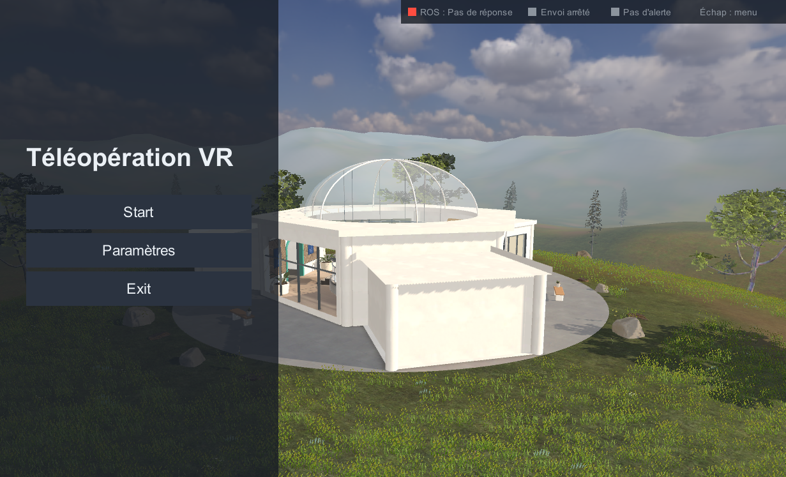
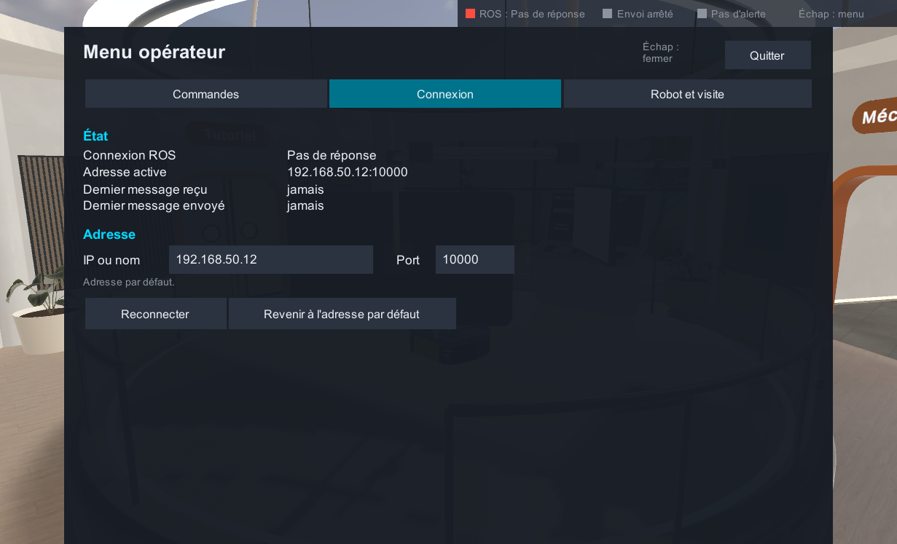
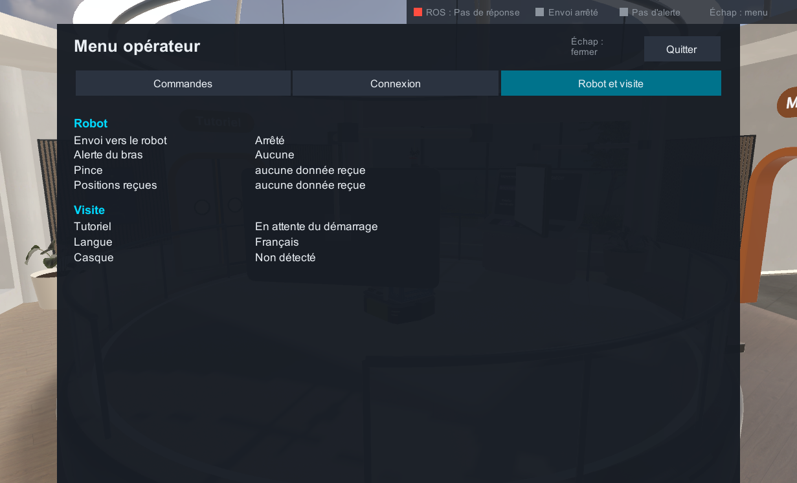
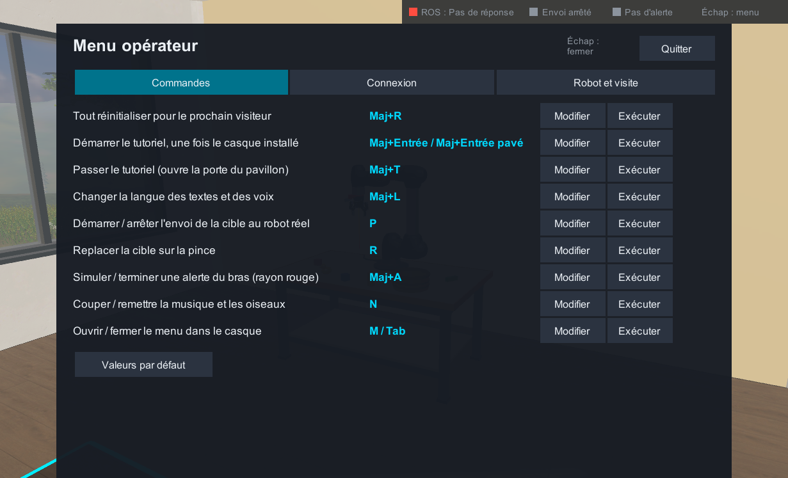

# 5. Installer le PC VR

> Chapitre pour le **technicien**. À faire une seule fois par PC VR.

Le PC VR est un PC **Windows** relié au casque **HTC Vive**. Il exécute :

1. **SteamVR** : le logiciel qui fait fonctionner le casque et les manettes ;
2. **l'application Leeloo VR** (un fichier `.exe` déjà compilé) : elle envoie la position de la main au Jetson.

Il n'y a **pas de ROS ni de Docker** sur ce PC.

## Étape 1 : brancher le matériel

1. Placer les deux **stations de base** en hauteur, face à face, dans les coins opposés de la zone, avec une vue dégagée.
2. Brancher le casque au PC (câble du casque) et allumer les stations de base.
3. Brancher le PC au routeur du robot **par un câble ethernet**.

## Étape 2 : installer SteamVR

1. Installer **Steam**, puis **SteamVR** depuis Steam.
2. Lancer SteamVR et suivre l'assistant de configuration de la « zone de jeu » (room-scale).
3. Vérifier que le casque et les deux manettes apparaissent **en vert** dans la fenêtre SteamVR.

> **À COMPLÉTER** : version de SteamVR utilisée et réglages importants.
> **Capture à ajouter** : fenêtre SteamVR avec casque, manettes et stations de base en vert.

## Étape 3 : installer l'application

1. Télécharger le fichier `.exe` : **À COMPLÉTER** (nom exact du fichier et lieu de distribution, par exemple la section « Releases » du dépôt git).
2. Le copier dans un dossier du PC, par exemple `C:\Leeloo\`.
3. Au premier lancement, Windows peut afficher un avertissement de sécurité : cliquer sur « Informations complémentaires », puis « Exécuter quand même ».

## Étape 4 : indiquer l'adresse du Jetson

L'application doit savoir à quelle adresse se connecter (le « bridge Unity », port `10000`).

1. Lancer l'application **avec SteamVR déjà ouvert**. L'écran du PC affiche l'écran-titre **« Téléopération VR »**, avec une visite du pavillon en fond :

   
   *L'écran-titre : « Start » ferme l'écran-titre, « Paramètres » ouvre le menu opérateur, « Exit » quitte l'application. En haut à droite, le bandeau des voyants (voir l'étape 5).*

2. Cliquer sur **« Paramètres »**, ou appuyer sur **Échap** à tout moment : le **menu opérateur** s'ouvre (onglets « Commandes », « Connexion », « Robot et visite »).
3. Onglet **« Connexion »** :
   - **« IP ou nom »** : l'adresse du Jetson (voir le [chapitre 3](03-reseau.md)), par exemple `192.168.50.12` ;
   - **« Port »** : `10000` ;
   - cliquer sur **« Reconnecter »**.
4. L'adresse est **sauvegardée** sur le PC : pas besoin de la ressaisir au lancement suivant. **« Revenir à l'adresse par défaut »** efface l'adresse sauvegardée.
5. Appuyer de nouveau sur **Échap** pour fermer le menu.

Si l'adresse est mal écrite, le menu affiche « Adresse non valide : il faut une IP comme 192.168.50.12 et un port de 1 à 65535. »

*L'onglet « Connexion ». En haut, « État » : la liaison avec le Jetson et l'heure du dernier message. En bas, « Adresse » : les champs « IP ou nom » et « Port » et le bouton « Reconnecter ». Ici, le robot était arrêté, d'où « Pas de réponse ».*

## Étape 5 : vérifier la connexion

La connexion ne marche que si le robot est démarré (voir le [chapitre 6](06-allumer-eteindre.md)) et si le module **« Casque VR »** de la page web est **Prêt**. Revenir à ce chapitre une fois le robot démarré.

En haut à droite de l'écran du PC, un **bandeau** montre trois voyants :

| Voyant | Bon état | Sinon |
|---|---|---|
| **ROS** | « ROS : Connecté » (vert) | « Pas de réponse » (rouge) ou « Déconnecté » : vérifier l'adresse (étape 4), le réseau et le module « Casque VR » |
| **Envoi** | « Envoi actif » (vert) **tant que le visiteur tient la gâchette** | « Envoi arrêté » (gris) quand la gâchette est relâchée : c'est normal |
| **Alerte** | « Pas d'alerte » | « ALERTE » : le bras est en alarme, voir le [chapitre 7](07-securite.md) |

L'envoi démarre et s'arrête **tout seul** avec la gâchette : rien à faire au lancement de l'application.

L'onglet **« Robot et visite »** du menu opérateur résume l'état : envoi vers le robot, alerte du bras, pince, positions reçues du robot, étape du tutoriel, langue, casque détecté ou non.

*L'onglet « Robot et visite ». Ici le robot et le casque n'étaient pas branchés : « aucune donnée reçue » et « Non détecté ».*

## Raccourcis clavier du PC VR

L'opérateur peut piloter la visite depuis le clavier du PC VR. La liste est aussi dans le menu opérateur (**Échap**, onglet « Commandes ») : le bouton **« Exécuter »** lance une action à la souris, **« Modifier »** change sa touche, et **« Valeurs par défaut »** remet les touches ci-dessous.

*L'onglet « Commandes », dans l'ordre d'une visite.*

Touches par défaut :

| Touche | Action |
|---|---|
| **Échap** | Ouvrir / fermer le menu opérateur |
| **Maj + Entrée** | Démarrer le tutoriel, une fois le casque installé |
| **Maj + T** | Passer le tutoriel (ouvre la porte du pavillon) |
| **Maj + R** | Tout réinitialiser pour le **visiteur suivant** (demande confirmation si une visite est en cours) |
| **P** | Démarrer / arrêter l'envoi de la cible au robot réel **sans la gâchette** (pour les tests sans casque ; **ne pas utiliser** pendant une visite) |
| **R** | Replacer la cible sur la pince |
| **Maj + L** | Changer la langue des textes et des voix |
| **N** | Couper / remettre la musique et les oiseaux |
| **M** ou **Tab** | Ouvrir / fermer le menu dans le casque |
| **Maj + A** | Simuler / terminer une alerte du bras (pour tester ; **ne pas utiliser** pendant une visite) |
