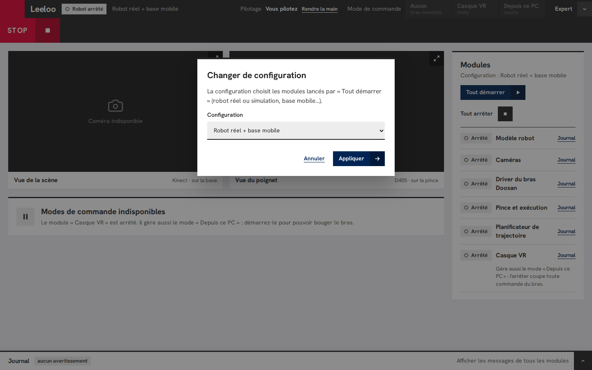
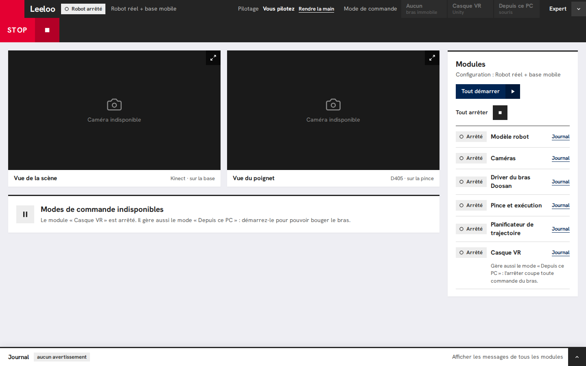

# 6. Allumer et éteindre

> Chapitre pour l'**opérateur**. Faire la check-list **dans l'ordre**, sans en sauter.

## Avant d'allumer

- [ ] La zone autour du robot est dégagée (personne, objet inutile).
- [ ] Les deux **arrêts d'urgence** sont accessibles (voir le [chapitre 7](07-securite.md)).
- [ ] Le canard et la boîte sont posés à leur place.
- [ ] Le Jetson et le PC VR sont branchés en **câble ethernet** au routeur.

## Allumer

1. **Routeur du robot.** Attendre 1 à 2 minutes qu'il soit prêt.
2. **Contrôleur Doosan.** L'allumer, attendre que le teach pendant ait démarré.
3. **Jetson.** L'allumer. Le conteneur démarre **tout seul**, ce qui prend environ 1 à 2 minutes. Ne rien faire de plus sur le Jetson.
4. **Page web** (tablette de l'opérateur) :
   1. Ouvrir `http://<IP du Jetson>:8080` (voir le [chapitre 3](03-reseau.md)).
   2. Cliquer sur **« Piloter depuis ce poste »** (en haut). Le bandeau doit indiquer que ce poste pilote.
   3. Vérifier que la configuration est **« Robot réel, bras seul (sans base) »** (la base mobile n'est pas utilisée). Elle est écrite en haut de la colonne « Modules ». Sinon : menu **Expert** (en haut à droite) → **« Changer de configuration… »**, choisir dans la liste, **Appliquer**. Ce n'est possible que si tous les modules sont arrêtés.

      
      *La fenêtre « Changer de configuration » (ici sur « Robot réel + base mobile », à remplacer par « Robot réel, bras seul (sans base) »).*
   4. Cliquer sur **« Tout démarrer »**.
   5. Attendre que **tous les modules soient « Prêt »** (voir plus bas). Le planificateur peut mettre **jusqu'à 2 minutes** la première fois : c'est normal.
5. **PC VR.** Allumer le PC, lancer **SteamVR**, vérifier que casque, manettes et stations sont verts, puis lancer l'application Leeloo VR. En haut à droite de l'écran du PC, le voyant doit indiquer **« ROS : Connecté »** (sinon voir le [chapitre 5](05-installer-pc-vr.md), étape 4).
6. **Casque.** Le visiteur met le casque seulement quand tout est prêt.

## Les modules attendus

| Module | État attendu | Si ce n'est pas le cas |
|---|---|---|
| Modèle robot | Prêt | Voir le [dépannage](11-depannage.md) |
| Caméras | Prêt (Kinect **et** D405) | Voir « caméra » dans le dépannage |
| Driver du bras Doosan | Prêt | Contrôleur Doosan en mode remote ? Câble réseau ? |
| Pince et exécution | Prêt | |
| Planificateur de trajectoire | Prêt | Attendre jusqu'à 2 minutes |
| Casque VR | Prêt | |
| Calibration main-œil | **Arrêté** (ne pas la démarrer) | |

*Après « Piloter depuis ce poste » : le bandeau indique « Vous pilotez » et « Tout démarrer » devient cliquable. Les modules sont encore « Arrêté ».*

> **Capture à ajouter (sur le robot réel)** : la même page avec tous les modules « Prêt » (en vert) et les images des caméras.

## Donner la main au casque

1. Dans le bandeau en haut de l'application web, **Mode de commande** : cliquer sur **« Casque VR »**.
2. Le bras doit être **immobile** pour que le mode soit accepté. Sinon, attendre un instant et réessayer.
3. Le visiteur peut commencer : **la gâchette doit être appuyée** pour que le bras bouge.

## Éteindre

1. Dire au visiteur de **retirer le casque**.
2. Mode de commande : **« Aucun »**.
3. Page web : cliquer sur **« Tout arrêter »** et attendre que tous les modules soient arrêtés.
4. Éteindre le **PC VR** (fermer SteamVR et l'application d'abord).
5. Éteindre le **Jetson** (menu du système, « Éteindre », ou `sudo shutdown now` pour le technicien). **Ne pas** couper l'alimentation sans éteindre.
6. Éteindre le **contrôleur Doosan** depuis le teach pendant.
7. Éteindre le **routeur** en dernier.

> Si le robot est dans une position inhabituelle ou proche d'un obstacle, **ne pas l'éteindre** tout de suite : demander au technicien.
