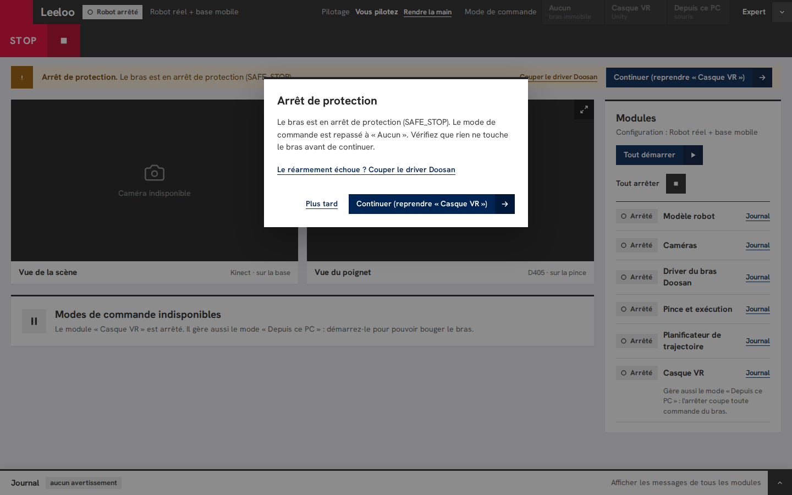
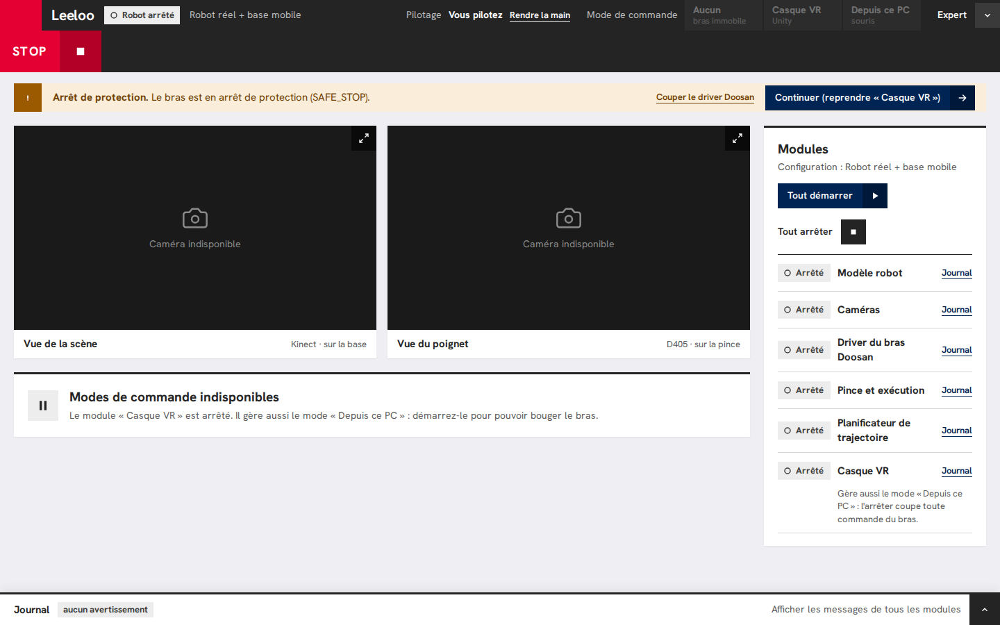
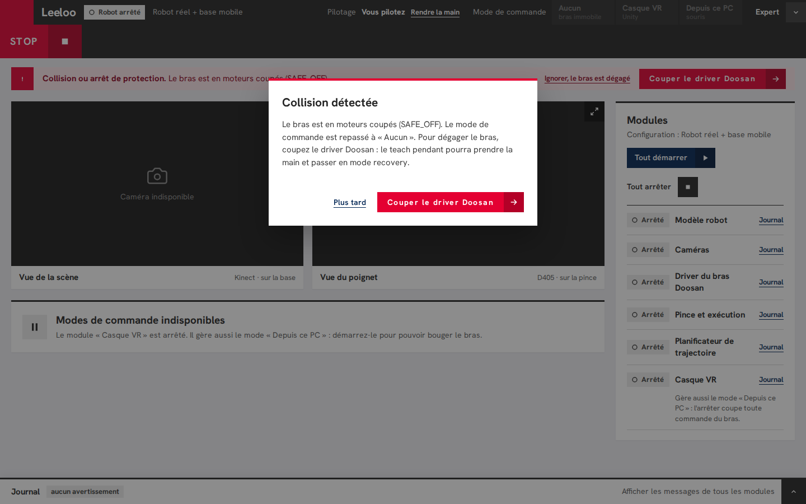
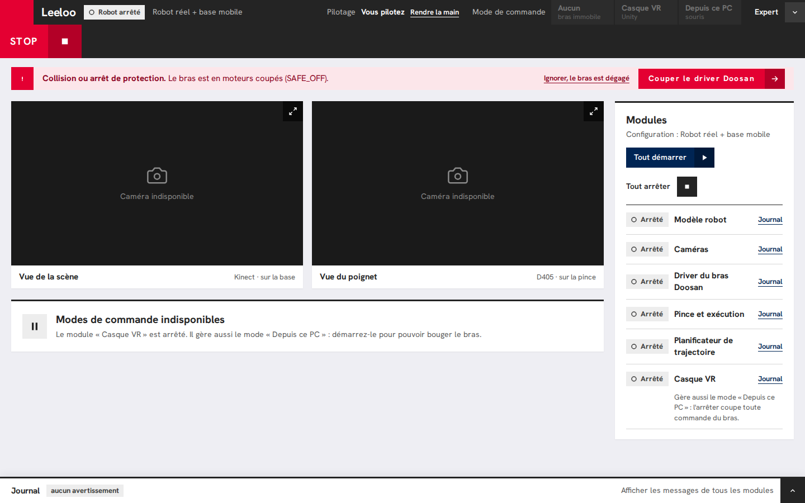
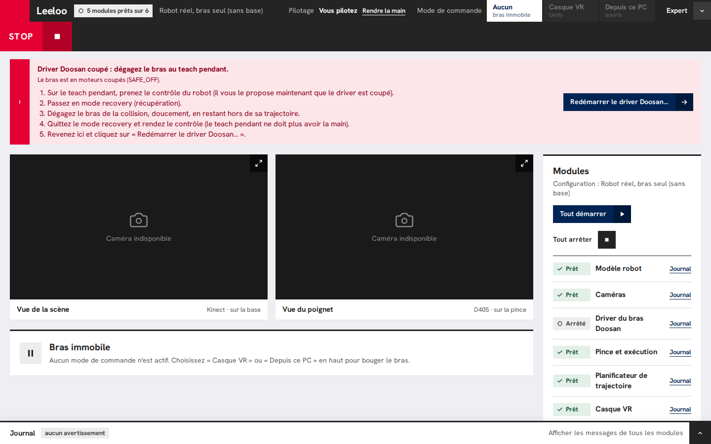

# 7. Sécurité

> **À lire avant la première utilisation. Une page à imprimer et à afficher près du robot : voir la fin de ce chapitre.**

Le bras Doosan M1013 est un robot industriel : il peut blesser et casser du matériel. Le logiciel ajoute des protections, mais **elles ne remplacent pas l'attention humaine**.

## Les règles de base

1. **Une personne surveille le robot en permanence**, la main à portée du STOP, **pas seulement le visiteur dans son casque**.
2. **Rien dans la zone du bras** pendant qu'il bouge : ni main, ni outil, ni sac. Le visiteur reste dans la zone de jeu, à distance du bras.
3. Le visiteur ne bouge le bras qu'en **maintenant la gâchette**. Il lâche : le bras s'arrête.
4. Si quelque chose paraît anormal (mouvement brusque, bruit, bras qui ne suit plus la main), **appuyer sur STOP d'abord, réfléchir ensuite**.
5. Le logiciel **ne redémarre jamais seul** un module en panne. C'est volontaire.
6. Le mode « **Doosan** » **ne vérifie pas les obstacles** (voir le [chapitre 10](10-curobo-doosan.md)) : surveiller le bras des yeux.

## Les trois façons d'arrêter le robot

| Moyen | Où | Quand l'utiliser |
|---|---|---|
| **Lâcher la gâchette** (visiteur) | Manette VR | Arrêt normal : le bras décélère jusqu'à l'arrêt. |
| **Bouton STOP** de la page web | Bandeau, en haut, **rouge** | Tout comportement anormal. Passe le mode de commande sur « Aucun », annule le mouvement et envoie un arrêt au bras. **Tout poste peut l'utiliser**, même en observation seule. |
| **Arrêt d'urgence physique** | **À COMPLÉTER** : emplacement (teach pendant, contrôleur, bouton mural) | Danger pour une personne, ou si la page web ne répond plus. Coupe l'alimentation moteur. |

Si la page web ne répond pas, STOP affiche « le serveur ne répond pas » : utiliser immédiatement l'**arrêt d'urgence physique**.

Si le réseau est coupé, la page web, le casque ou le Wi-Fi perdent la liaison : le bras s'arrête (silence du casque ou de la page pendant une fraction de seconde = arrêt).

## Ce que fait le logiciel tout seul

- **Zone de travail limitée** : le bras ne sort pas d'une boîte virtuelle autour du robot.
- **Vitesse limitée** (environ 20 cm/s au bout de la pince).
- **Maintien obligatoire** : sans gâchette appuyée, ou sans signal du casque pendant 0,2 s, le bras s'arrête.
- **Démarrage depuis la position réelle** : le bras ne « saute » jamais vers la main du visiteur au début.
- **Bras immobile obligatoire** pour changer de mode ou de contrôleur.
- **Aucun redémarrage automatique** des modules critiques : un module en échec reste en échec.

## Si le bras s'est arrêté tout seul : alarme jaune ou rouge

Le bras peut s'arrêter de lui-même (collision, protection du bras). La page web affiche alors un message, et le mode de commande repasse sur **« Aucun »**.

### Alarme jaune (arrêt de protection)

Le bras a détecté un choc ou une situation limite et s'est mis en sécurité.

1. **Vérifier** que le bras est dégagé et que personne n'est en danger.
2. Sur le poste **pilote**, cliquer sur **« Continuer (reprendre … ) »**. Le logiciel réarme le bras et reprend le mode précédent.
3. En **casque VR**, le visiteur doit **relâcher puis réappuyer sur la gâchette** pour repartir.
4. Si « Continuer » échoue, ou si le choc est sérieux : **« Couper le driver Doosan »** et suivre la procédure rouge.

Sur le poste pilote, une fenêtre **« Arrêt de protection »** s'ouvre :

*La fenêtre jaune « Arrêt de protection », avec le bouton « Continuer (reprendre « Casque VR ») ». Le lien « Le réarmement échoue ? Couper le driver Doosan » sert de secours.*

Avec « Plus tard », la fenêtre se ferme, mais un **bandeau jaune** reste affiché en haut de la page. Il propose les mêmes actions. Les autres postes ne voient que ce bandeau.

*Le bandeau jaune reste en haut de la page tant que le bras n'est pas réarmé.*

*Captures faites avec une alarme simulée (aucun robot connecté). Les textes et les boutons sont ceux de la vraie interface.*

### Alarme rouge (panne)

Le bras est bloqué et doit être remis en état à la main.

1. Cliquer sur **« Couper le driver Doosan »** (le bras est alors libéré pour le teach pendant).
2. Avec le **teach pendant** (la page affiche cette liste) :
   1. prendre le contrôle du robot (le teach pendant le propose une fois le driver coupé) ;
   2. passer en **mode recovery** (récupération) ;
   3. dégager le bras de la collision, **doucement**, en restant hors de sa trajectoire ;
   4. quitter le mode recovery et **rendre le contrôle** (le teach pendant ne doit plus avoir la main).
3. Revenir à la page web et cliquer sur **« Redémarrer le driver Doosan… »**. La page demande une liste de vérification.
4. Remettre le mode de commande, comme au [chapitre 6](06-allumer-eteindre.md).

*La fenêtre rouge « Collision détectée » et son bouton « Couper le driver Doosan ».*

*Le bandeau rouge reste affiché après « Plus tard ». « Ignorer, le bras est dégagé » ne sert que si le bras est vraiment libre.*

*Captures faites avec une alarme simulée (aucun robot connecté). Les textes et les boutons sont ceux de la vraie interface.*

Après « Couper le driver Doosan », la page affiche ce bandeau jusqu'au redémarrage du driver :

*Le bandeau « Driver Doosan coupé : dégagez le bras au teach pendant. », avec les étapes à faire au teach pendant et le bouton « Redémarrer le driver Doosan… » (état simulé, aucun robot connecté).*

Si l'alarme revient plusieurs fois de suite, **arrêter la démonstration** et appeler le technicien.

---
