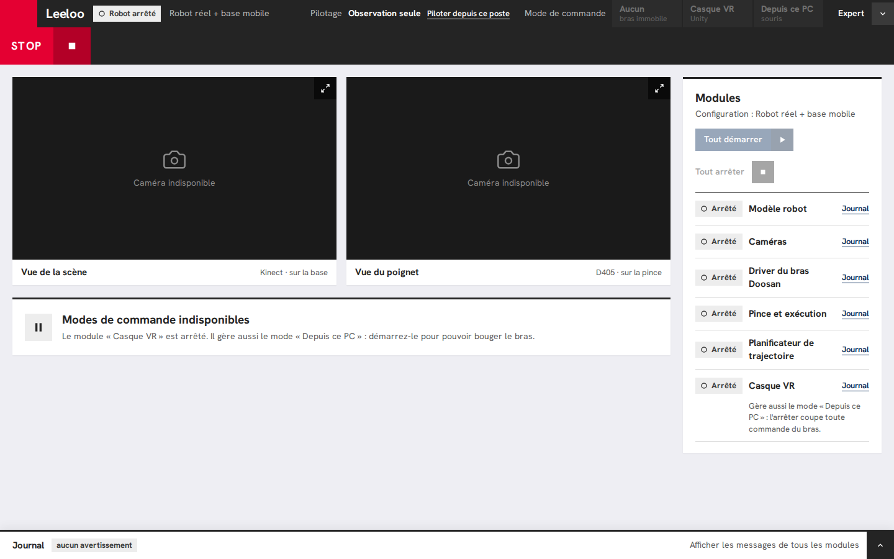
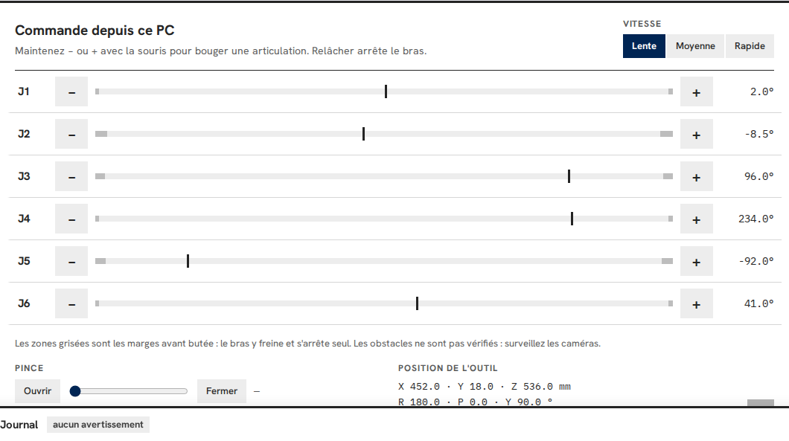
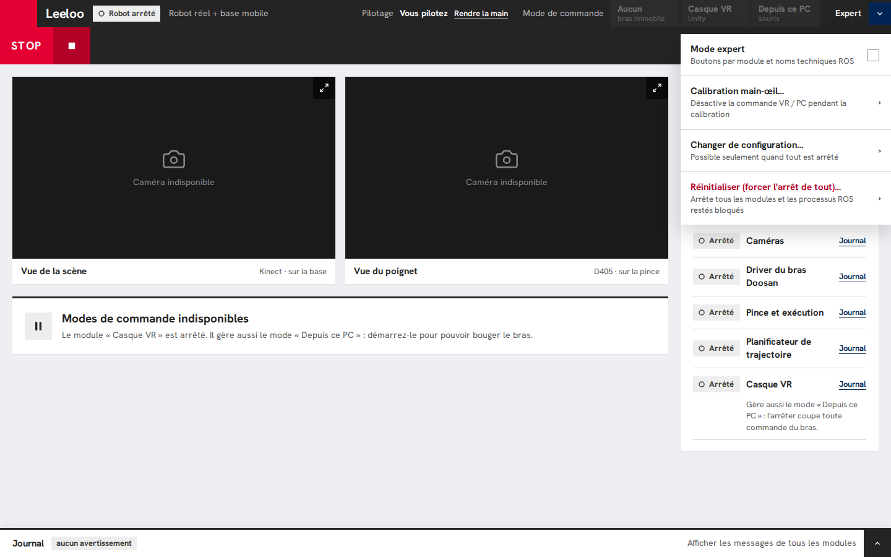
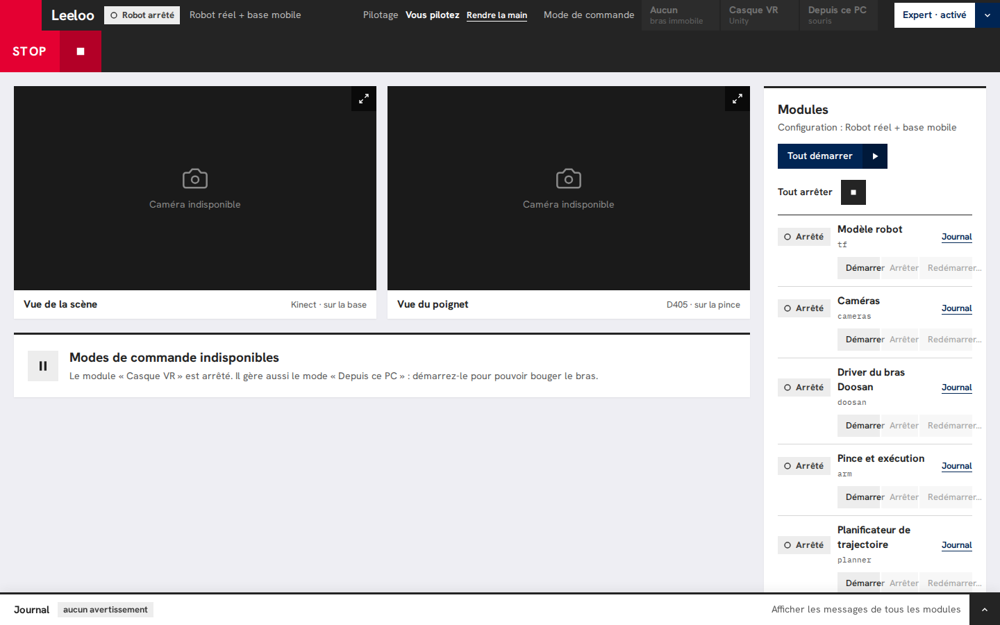
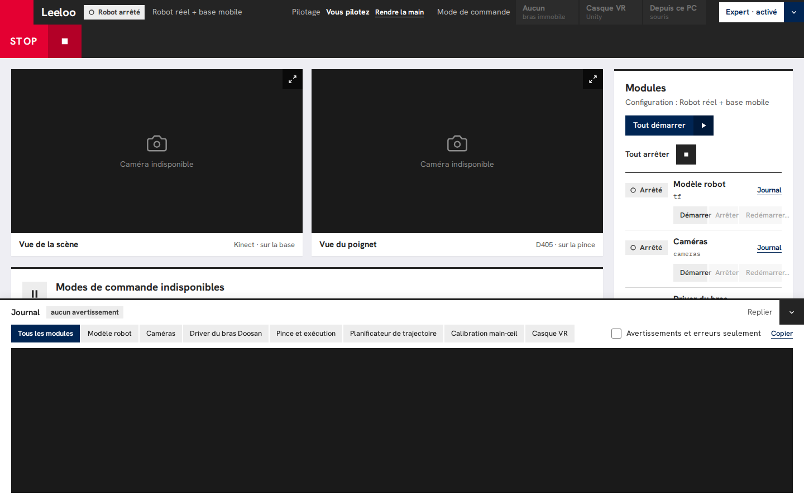

# 8. La page web

> Chapitre pour l'**opérateur**. La page est accessible à l'adresse `http://<IP du Jetson>:8080` (voir le [chapitre 3](03-reseau.md)).

## Vue générale

La page est divisée en quatre zones :

| Zone | Contenu |
|---|---|
| **Bandeau du haut** | État global du robot, qui pilote, **Mode de commande**, menu **Expert**, bouton **STOP** (rouge) |
| **Centre** | Images des caméras (Kinect et D405) et, en mode « Depuis ce PC », les commandes du bras |
| **Colonne de droite** | La liste des **modules** et leur état, boutons **Tout démarrer** / **Tout arrêter**, choix de la **Configuration** |
| **Tiroir « Journal »** | Messages du logiciel (pour le technicien) |

*En haut, le bandeau (STOP, état, configuration, pilotage, mode de commande, Expert). Au centre, les caméras « Vue de la scène » et « Vue du poignet ». À droite, les modules. En bas, le tiroir « Journal ». Ici tout est arrêté.*

## Piloter ou observer

Un **seul poste** peut piloter le robot à la fois. Les autres sont en **« Observation seule »** : ils voient tout, mais ne commandent rien (sauf **STOP**).

- Pour prendre la main : **« Piloter depuis ce poste »**. Le bandeau affiche alors **« Vous pilotez »**, et **« Rendre la main »** permet de la céder.
- Si un autre poste pilotait, il passe en observation et le mode de commande repasse à « Aucun ».
- Si le poste pilote perd sa connexion (tablette éteinte, Wi-Fi coupé), le mode repasse à « Aucun » : **le bras s'arrête**.

## Les modules

Chaque module affiche un état :

| État | Couleur | Sens |
|---|---|---|
| **Prêt** | Vert | Le module fonctionne. |
| **Problème** | Ambre | Il tourne, mais avec un défaut (le texte explique lequel). |
| **Échec** | Rouge | Il ne s'est pas lancé ou s'est arrêté. |
| **Arrêté** | Gris | Volontairement éteint. |

**Tout démarrer** lance les modules dans le bon ordre. **Tout arrêter** les coupe dans l'ordre inverse. Les modules du robot réel :

| Module | Rôle |
|---|---|
| Modèle robot | Décrit le robot (positions des caméras et du bras) |
| Caméras | Kinect (fixe) et D405 (poignet) |
| Driver du bras Doosan | Dialogue avec le bras |
| Pince et exécution | Pince et envoi des mouvements au bras |
| Planificateur de trajectoire | cuRobo : calcul des mouvements en évitant les obstacles |
| Calibration main-œil | **Ne pas utiliser** (Jamais testé projet pour plus tard) |
| Casque VR | Passerelle avec le casque, **gère aussi le mode « Depuis ce PC »** |

> Si le module **Casque VR** est arrêté, le bras ne peut être commandé **ni par le casque ni par la souris**.

## Mode de commande

Dans le bandeau, trois boutons :

| Mode | Effet |
|---|---|
| **Aucun** | Le bras est immobile. Mode sûr, par défaut. |
| **Casque VR** | Le bras suit la manette VR (gâchette maintenue). |
| **Depuis ce PC** | Le bras se commande à la souris, avec les boutons de la page. |

Règles :

- Pour passer de « Casque VR » à « Depuis ce PC » (ou l'inverse), la page passe d'abord par « Aucun » et demande confirmation.
- Un mode n'est accepté que si le bras est **immobile** et les modules nécessaires **Prêts** (sinon, un message explique ce qui manque).
- Changer de mode **annule** la gâchette : il faut la relâcher puis la réappuyer.
- Pendant une calibration, les deux modes sont désactivés.

## Commander à la souris (« Depuis ce PC »)

Le panneau central propose des boutons pour chaque articulation (J1 à J6, de la base vers la pince) et la pince.

- **Maintenir** le bouton de la souris sur « + » ou « − » : l'articulation tourne. **Relâcher** : elle s'arrête. (C'est le « maintien » : pas de raccourci clavier, volontairement.)
- Trois **vitesses** au choix : lente (5 °/s), moyenne (10 °/s), rapide (20 °/s).
- Un curseur commande l'ouverture de la **pince** (0 à 100 %).
- Des barres indiquent la **position** de chaque articulation par rapport à ses limites : le bras ralentit avant d'arriver en butée.
- La **pose de la pince** (position et orientation) est affichée en lecture seule.

> **À vérifier avant de publier** : par défaut, le contrôleur de la page est « Doosan », et dans ce cas la commande articulaire est grisée avec le message « Contrôleur Doosan actif : jog articulaire indisponible ». Pour l'utiliser : mode **Expert**, onglet **Outil (TCP)**, contrôleur **cuRobo**.

*Le panneau « Commande depuis ce PC » : vitesses en haut à droite, boutons « − » / « + » pour J1 à J6 (les zones grisées sont les marges avant butée), pince en bas à gauche et position de l'outil en bas à droite. État simulé, contrôleur cuRobo.*

## Le mode Expert

Le bouton **Expert** (en haut à droite) ouvre un menu. On y trouve la case **« Mode expert »**, et les actions **Calibration main-œil…**, **Changer de configuration…** et **Réinitialiser (forcer l'arrêt de tout)…**

*Le menu Expert. Cocher « Mode expert » pour afficher les fonctions supplémentaires.*

Une fois la case cochée, le bouton affiche **« Expert · activé »**. Chaque module montre son nom technique (`tf`, `cameras`, `doosan`…) et ses boutons **Démarrer / Arrêter / Redémarrer…**

*Mode expert activé : boutons par module et noms techniques.*

Le mode expert sert à :

| Fonction | Où |
|---|---|
| **Choisir le contrôleur du casque** (cuRobo ou Doosan) | Panneau « Casque VR » → « Contrôleur du casque » |
| Commander l'**outil** (position de la pince) à la souris | Onglet « Outil (TCP) » |
| Démarrer / arrêter chaque module un par un | Boutons de chaque module |
| **Réinitialiser** : tout arrêter et tuer les processus bloqués (demande le PIN) | Menu Expert |
| Calibration main-œil | Menu Expert (**ne pas utiliser**) |

Le mode Expert **n'est pas réservé au technicien** : l'étudiant l'utilise à chaque démonstration pour changer de contrôleur (voir le [chapitre 10](10-curobo-doosan.md)). **Le désactiver ensuite** si on ne s'en sert plus.

## Le bouton STOP

Toujours visible, rouge. Il met le mode sur **« Aucun »**, annule le mouvement en cours et envoie un arrêt au bras. Utilisable par **tous les postes**. Voir le [chapitre 7](07-securite.md).

## Actions qui demandent le code PIN

Redémarrer le driver Doosan, **Réinitialiser**, et changer de configuration demandent un **code PIN**. La page l'indique et accepte jusqu'à réussite (« Code incorrect, réessayez »). **À COMPLÉTER** : qui connaît le code.

## Le Journal

Le tiroir **Journal** liste ce que chaque module écrit (le chiffre sur le bouton compte les alertes). L'opérateur n'en a pas besoin. En cas de panne, **le technicien** peut cliquer sur **Copier** pour envoyer le texte.

*Le Journal ouvert : un filtre par module, la case « Avertissements et erreurs seulement », et le lien « Copier ».*
