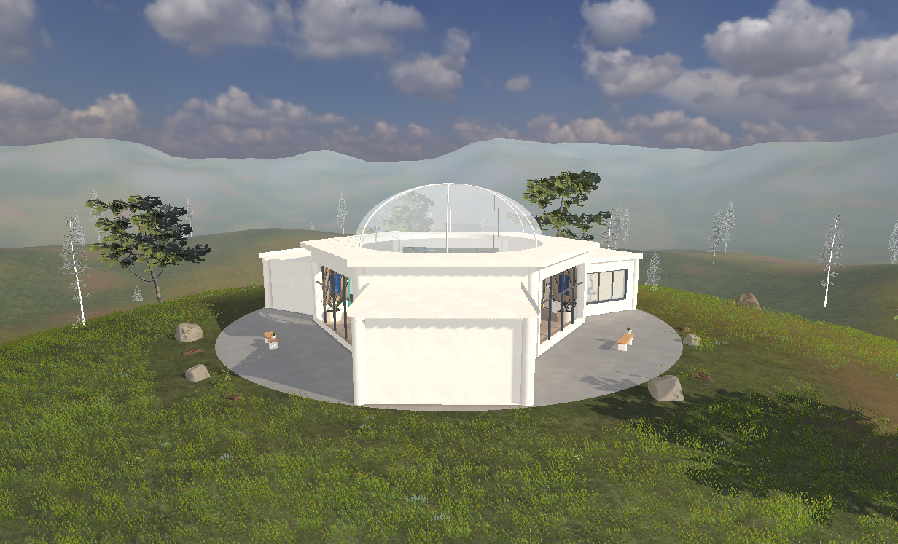
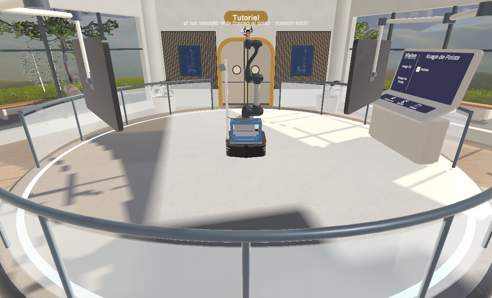
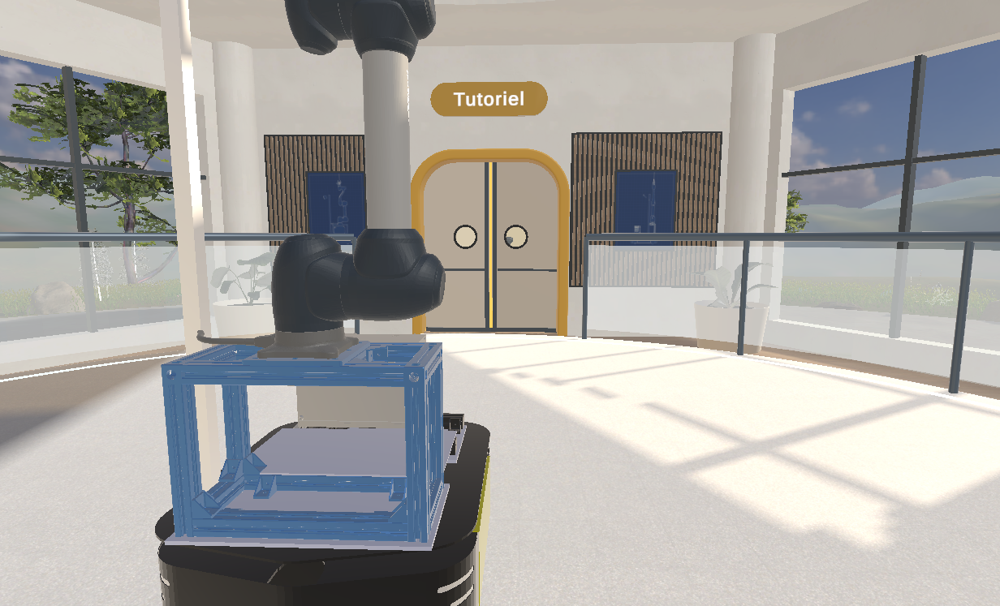

# 9. Le casque VR

> Chapitre pour l'**opérateur** et le **visiteur** (à lire à voix haute si besoin).

## Ce que voit le visiteur

Le visiteur est dans un **pavillon virtuel** posé sur une colline, avec le robot devant lui.

*Le pavillon vu de l'extérieur (vue de visite de l'application, capturée depuis l'éditeur Unity).*

Au centre, le robot Leeloo (le même que le vrai) bouge comme le vrai robot. Des écrans autour montrent notamment la **« Caméra du poignet »** et le **nuage de points** (« Vision »), et un message rappelle la mission : « saisir le canard et le déposer… ».

*Le robot virtuel au centre, le panneau « Vision / Nuage de points » à droite et la porte « Tutoriel » au fond (capture depuis l'éditeur Unity, pas depuis le casque).*

Au début, un **tutoriel** accompagne le visiteur :

*La porte « Tutoriel » et le robot (capture depuis l'éditeur Unity).*

1. **Se déplacer** : la plateforme sous ses pieds est son espace de déplacement (aucun obstacle).
2. **Se téléporter** : poser le doigt sur le haut du **pad circulaire** de la manette : un rayon apparaît. Le **pointer vers le sol** et **appuyer sur le pad** pour s'y téléporter. S'approcher du robot.
3. **Piloter le robot** : appuyer sur la **gâchette** : le robot suit tous les mouvements de la main.

## Règles à dire au visiteur avant de mettre le casque

- **Garder la gâchette appuyée** pour bouger le bras. **Relâcher** pour l'arrêter.
- **Aller doucement.** Le bras suit avec un léger retard et limite sa vitesse : il ne rattrape pas un geste rapide.
- Si le bras s'arrête, **relâcher puis réappuyer** sur la gâchette.
- **Ne pas lutter** contre un arrêt : c'est une protection.
- Le visiteur reste dans la zone de jeu. L'opérateur reste à côté, sa main près du STOP.

## La pince

La pince s'ouvre et se ferme avec la manette. **À COMPLÉTER** : quel bouton de la manette commande la pince, dans quel sens, et comment le visiteur sait que la pince est fermée.

## Pourquoi le bras s'arrête ou ne suit plus ?

| Cause | Ce que voit le visiteur | Que faire |
|---|---|---|
| La gâchette est relâchée | Le bras s'arrête | Réappuyer |
| La main est sortie de la zone de travail | Le bras s'arrête au bord d'une boîte virtuelle | Revenir vers le centre |
| La main bouge trop vite | Le bras suit en retard | Aller plus doucement |
| cuRobo bloque (canard dans la pince, obstacle proche) | Le bras ne suit plus | Voir le [chapitre 10](10-curobo-doosan.md) |
| Alarme du bras | Message dans le casque ou sur la tablette | Voir le [chapitre 7](07-securite.md) |
| Limite de l'articulation J4 atteinte (mode Doosan) | « Arrêté : J4 près de 240° » | Relâcher la gâchette et repartir dans l'autre sens |

## Déroulé pour l'opérateur

1. Vérifier que tous les modules sont **Prêts** et le mode de commande sur **« Casque VR »** (voir le [chapitre 6](06-allumer-eteindre.md)).
2. Aider le visiteur à mettre le casque et à prendre les manettes.
3. Sur le clavier du PC VR, **Maj + Entrée** lance le tutoriel (se déplacer, se téléporter). **Maj + T** le passe.
4. Vérifier sur l'écran du PC VR que le bandeau indique **« ROS : Connecté »**. Le voyant « Envoi » passe à **« Envoi actif »** dès que le visiteur appuie sur la gâchette (voir le [chapitre 5](05-installer-pc-vr.md#étape-5--vérifier-la-connexion)).
5. Le laisser attraper le canard (voir le [chapitre 12](12-annexes.md)).
6. Pour déposer le canard dans la boîte : **changer de contrôleur** (voir le [chapitre 10](10-curobo-doosan.md)).
7. Fin : retirer le casque, mode sur « Aucun ».
8. Avant le visiteur suivant : **Maj + R** sur le PC VR (réinitialise la visite), et remettre **cuRobo**.
