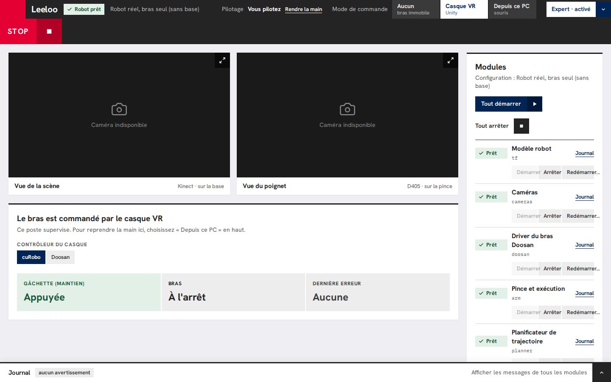

# 10. cuRobo ou Doosan : quel contrôleur et quand

Le casque peut commander le bras de **deux manières**, appelées **contrôleurs**. Le choix se fait dans la page web, en **mode Expert** (voir le [chapitre 8](08-page-web.md)).

## En une phrase

> **cuRobo pour approcher et saisir. Doosan pour déposer.**
> Par défaut, le casque démarre en **cuRobo**.

## Les deux contrôleurs

| | **cuRobo** (défaut) | **Doosan** |
|---|---|---|
| Principe | Calcule une trajectoire avec le GPU du Jetson | Envoie la position cible directement au contrôleur du bras |
| **Obstacles** | **Évités** : il voit la scène avec les caméras | **Non vérifiés** : surveiller le bras des yeux |
| Fluidité | Très bonne | Bonne |
| Stabilité | Stable | **Plus instable** : peut changer brusquement la configuration du bras |
| Quand | Approche, saisie, déplacement libre | **Dépose** (quand cuRobo est gêné) |

## Pourquoi cuRobo se bloque quand le canard est dans la pince

Une fois le canard saisi, les caméras le voient **dans la pince**, **très près du bras**. cuRobo le prend pour un **obstacle à éviter** et le considère comme une collision imminente. Cela **perturbe son calcul de trajectoire**.

**Ce que voit l'opérateur** : le bras **n'avance plus**, ou saccade, alors que la main du visiteur continue de bouger.

**La solution** : passer en **Doosan**, qui ne se préoccupe pas des obstacles. Il suffit alors de guider le bras jusqu'à la boîte et de lâcher le canard.

## Pourquoi ne pas toujours utiliser Doosan

Le contrôleur Doosan ne voit pas les obstacles et il est sensible aux **singularités** : certaines positions du bras (en particulier quand l'articulation **J4** s'approche de **240°**) le font **changer brusquement de configuration**. Le bras fait alors un mouvement brusque et le Doosan se met en alarme.

Pour l'éviter, le logiciel **interdit à J4 de dépasser 240°**. Mais le risque ne disparaît pas :

- Le bras peut s'**arrêter**, avec le message « Arrêté : J4 près de 240° ». Relâcher la gâchette, puis repartir dans l'**autre sens**.
- Une **alarme** (jaune ou rouge) peut apparaître et **bloquer le visiteur** : voir le [chapitre 7](07-securite.md) (« Continuer » pour le jaune).

## Procédure : passer de cuRobo à Doosan

À faire quand le canard est saisi et que cuRobo ne suit plus.

1. Le visiteur **relâche la gâchette**.
2. L'opérateur **attend que le bras soit complètement immobile**. Un changement de contrôleur est refusé sinon.
3. Ouvrir le menu **Expert** (en haut à droite) et cocher **« Mode expert »** (voir la capture au [chapitre 8](08-page-web.md#le-mode-expert)).
4. Dans le panneau **« Casque VR »**, ouvrir **« Contrôleur du casque »** et cliquer sur **« Doosan »**.
5. Le message « Contrôleur Doosan : obstacles non vérifiés, surveillez les caméras » apparaît : **surveiller le bras**.
6. Le visiteur **reprend la gâchette** et guide le canard au-dessus de la boîte.
7. Il **relâche le canard** (ouvre la pince).

*Le panneau « Casque VR » en mode Expert : « Contrôleur du casque » avec les boutons « cuRobo » (actif ici) et « Doosan » (état simulé : valeurs et caméras fictives).*

## Revenir à cuRobo

Même procédure (bras immobile, gâchette relâchée), en cliquant sur **« cuRobo »**.

Le contrôleur est **conservé** quand on change de mode de commande, mais **redevient « cuRobo »** si le module « Casque VR » (ou le conteneur) est redémarré. **Penser à remettre cuRobo avant le visiteur suivant.**

## Pourquoi le contrôleur n'est pas choisi automatiquement

Parce que la bascule dépend de ce qui se passe dans la pince et dans la scène. Elle est volontairement laissée à l'opérateur, qui voit le robot.

## Règles de sécurité pour le mode Doosan

- Une personne **regarde le bras** pendant tout le temps où le contrôleur est en Doosan.
- La rotation de la pince est limitée à environ **10 °/s**, et la cible ne peut pas dépasser la position réelle de la pince de plus de quelques centimètres.
- En cas de doute : **STOP**, puis revenir en cuRobo.
